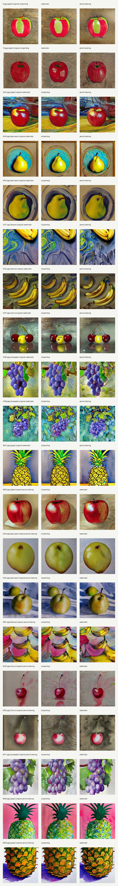

# LoRA를 활용한 과일 이미지 스타일 변환

Stable Diffusion 1.5와 LoRA를 활용해 과일 이미지의 화풍을 변환하는 개인 실험 프로젝트입니다. Apple Silicon Mac에서 PyTorch MPS로 모델을 학습하고, img2img 방식으로 이미지를 생성합니다.

유화, 수채화, 색연필화 스타일별로 LoRA 어댑터를 학습한 뒤, 원본 과일의 형태와 구도를 유지하면서 다른 두 가지 스타일로 변환하는 것을 목표로 합니다.

## 결과 미리보기



각 행은 다음 순서로 구성됩니다. 변환 대상 스타일은 원본 이미지의 스타일에 따라 달라집니다.

```text
원본 이미지 | 첫 번째 대상 스타일 | 두 번째 대상 스타일
```

## 주요 기능

- 과일 및 스타일 라벨을 바탕으로 학습 데이터를 스타일별로 분리합니다.
- 유화, 수채화, 색연필화에 대한 LoRA 어댑터를 각각 학습합니다.
- 테스트 이미지에 img2img 방식의 스타일 변환을 적용합니다.
- 원본과 생성 결과를 한눈에 비교할 수 있는 이미지 모음(contact sheet)을 만듭니다.

## 실행 환경

- Apple Silicon Mac 및 macOS
- Python 3.10 이상 — 이 프로젝트에서는 Python 3.12.15를 사용했습니다.
- VSCode 및 Python 가상환경
- PyTorch MPS를 이용한 GPU 연산

아래 명령어는 `task2_mac` 프로젝트 폴더의 터미널에서 실행합니다.

## 1. 설치 및 환경 확인

Python 3.12가 설치되어 있다는 기준으로 가상환경을 생성합니다.

```bash
python3.12 -m venv .venv
source .venv/bin/activate
python -m pip install --upgrade pip
pip install -r requirements.txt
pip install -e .
```

이미 가상환경을 만들었다면, 다음 작업부터는 아래 명령어로 활성화하면 됩니다.

```bash
source .venv/bin/activate
```

MPS 사용 가능 여부를 확인합니다.

```bash
python scripts/check_device.py
```

출력에 다음 내용이 포함되면 MPS를 사용할 수 있습니다.

```text
mps available: True
selected device: mps
```

## 2. 데이터 준비

데이터는 아래 구조로 배치합니다. 데이터셋은 이 저장소에 포함되어 있지 않습니다.

```text
data/
  train/images/
    0.jpg
    1.jpg
    ...
  test/images/
    9.jpg
    2622.jpg
    ...
  train_labels.csv
```

테스트 이미지는 `data/test/images/` 안에 넣습니다. 현재 코드는 테스트 이미지를 찾지 못하면 학습 이미지로 대체하므로, 실행 전에 경로를 확인해야 합니다.

라벨 CSV에는 이미지 식별 정보와 스타일·과일 라벨이 필요합니다. 예를 들어 다음과 같은 열 이름을 사용할 수 있습니다.

```csv
file_name,style,fruit
0.jpg,0,0
```

`id`, `image_id`, `filename`, `style_label`, `fruit_label` 등의 열 이름도 인식합니다. 이미지 파일명에는 이미지 ID에 해당하는 숫자가 포함되어야 합니다. 라벨 번호와 `configs/task2_mac.yaml`의 스타일·과일 설정을 일치시켜 주세요.

## 3. LoRA 학습 데이터 생성

```bash
python scripts/prepare_lora_data.py --config configs/task2_mac.yaml
```

다음 폴더에 스타일별 학습 이미지 복사본과 캡션 정보(`metadata.jsonl`)가 생성됩니다.

```text
work/lora_data/style_0/
work/lora_data/style_1/
work/lora_data/style_2/
```

## 4. 스타일별 LoRA 학습

세 가지 스타일을 순서대로 학습합니다.

```bash
python scripts/train_all_styles.py --config configs/task2_mac.yaml
```

특정 스타일만 학습하려면 스타일 ID를 지정합니다. `0`은 유화, `1`은 수채화, `2`는 색연필화입니다.

```bash
python scripts/train_style_lora.py --config configs/task2_mac.yaml --style-id 0
```

학습한 LoRA는 다음 위치에 저장됩니다.

```text
models/lora/style_0/
models/lora/style_1/
models/lora/style_2/
```

## 5. 스타일 변환 이미지 생성

```bash
python scripts/generate_task2.py --config configs/task2_mac.yaml
```

현재 설정에서는 최대 20장의 테스트 이미지를 사용하며, 결과는 `release/generated/`에 저장됩니다. 파일명 형식은 다음과 같습니다.

```text
{image_id}_generate_{target_style_id}.jpg
```

이미 학습한 LoRA가 있다면, 생성 설정만 바꿀 때는 재학습 없이 이 단계부터 실행할 수 있습니다.

### 현재 생성 설정

설정은 `configs/task2_mac.yaml`에서 변경합니다.

| 항목 | 값 | 의미 |
| --- | --- | --- |
| `strength` | `0.55` | 원본 이미지에 적용하는 변환 강도 |
| `lora_scale` | `1.0` | 학습한 LoRA의 적용 강도 |
| `num_inference_steps` | `32` | 이미지 생성 단계 수 |
| `guidance_scale` | `7.5` | 프롬프트를 따르는 강도 |
| `seed` | `1234` | 난수 시드 |

이 값은 현재 실험에서 사용한 설정이며, 모든 이미지에 대한 최적값을 의미하지는 않습니다.

## 6. 결과 비교 이미지 생성

```bash
python scripts/make_contact_sheet.py --config configs/task2_mac.yaml
```

원본과 생성 결과를 모은 이미지가 다음 위치에 저장됩니다.

```text
release/contact_sheet.jpg
```

GitHub에 결과를 공유하려면 선택한 이미지를 `examples/`에 복사합니다. README의 미리보기는 `examples/contact_sheet.jpg`를 사용합니다.

## 참고 사항 및 한계

- 기본 모델은 Stable Diffusion 1.5이며, 이 프로젝트의 로컬 학습과 생성은 해당 모델을 기준으로 진행했습니다.
- 최초 실행 시 기본 모델을 내려받기 위한 인터넷 연결이 필요합니다. 모델의 접근 정책에 따라 Hugging Face 인증이 필요할 수 있습니다.
- 일부 결과에서는 과일의 형태와 구도가 유지되지만, 목표한 화풍의 차이가 뚜렷하지 않습니다.
- 결과 품질은 원본 이미지, 변환 강도, LoRA 적용 강도 등에 따라 달라집니다. 변환 과정에서 형태가 왜곡되기도 합니다.
- 개인 학습 및 실험을 위한 프로젝트이며, 상용 서비스 수준의 품질을 검증한 것은 아닙니다.

## 파일 보관 및 용량 관리

다음 폴더는 `.gitignore`에 등록되어 GitHub에 업로드되지 않습니다.

| 폴더 | 내용 |
| --- | --- |
| `data/` | 원본 학습·테스트 데이터 및 라벨 |
| `work/` | 전처리한 학습 데이터 복사본과 캡션 |
| `models/` | 학습한 LoRA 및 중간 체크포인트 |
| `release/` | 생성 이미지와 결과 비교 이미지 |
| `.venv/` | Python 가상환경 |

학습이 끝난 뒤 용량을 정리하려면 `work/lora_data/`의 학습용 복사본과 `models/lora/style_*/checkpoint-*`의 중간 가중치부터 검토할 수 있습니다. 학습 데이터 준비 명령어로 복사본을 다시 만들 수 있습니다.

학습한 LoRA를 다시 사용하려면 각 `models/lora/style_*/` 폴더의 최종 `pytorch_lora_weights.safetensors`와 `style_info.json`을 보관하세요. 모델은 GitHub에 백업되지 않으므로 별도로 보관해야 합니다.
