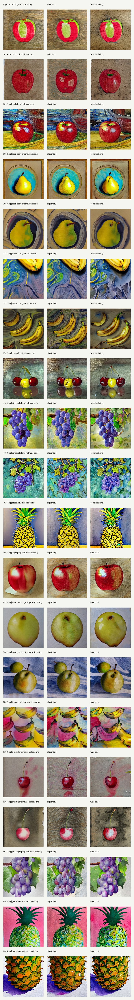

# Fruit Style Transfer with LoRA

Local Apple Silicon pipeline for fruit image style transfer using Stable Diffusion 1.5, LoRA fine-tuning, and img2img generation.

The project trains one LoRA adapter per visual style, then converts each evaluation image into the other styles while trying to preserve the original fruit identity.

## Result Preview



Each row shows:

```text
original image | generated style 1 | generated style 2
```

## What This Does

- Trains separate LoRA adapters for oil painting, watercolor, and pencil coloring styles.
- Uses fruit/style labels to split the training data by style.
- Generates style-transferred images from a small evaluation set.
- Builds a contact sheet for quick visual comparison.

## Environment

This project was built for local development on macOS with Apple Silicon and PyTorch MPS.

## 1. Setup

```bash
python3 -m venv .venv
source .venv/bin/activate
python -m pip install --upgrade pip
pip install -r requirements.txt
pip install -e .
```

Check MPS:

```bash
python scripts/check_device.py
```

Expected output should include:

```text
mps available: True
selected device: mps
```

## 2. Data

Recommended layout:

```text
data/
  train/images/
    0.jpg
    1.jpg
    ...
  test/images/
    9.jpg
    2622.jpg
    ...
  train_labels.csv
```

The label CSV can use any of these common column names:

```text
id,file_name,style_label,fruit_label
```

If your CSV uses slightly different names such as `image_id`, `filename`, `style`, or `fruit`, the loader tries to recognize them.

The dataset is not included in this repository.

## 3. Prepare LoRA Training Sets

```bash
python scripts/prepare_lora_data.py --config configs/task2_mac.yaml
```

This creates:

```text
work/lora_data/style_0/metadata.jsonl
work/lora_data/style_1/metadata.jsonl
work/lora_data/style_2/metadata.jsonl
```

## 4. Train Style LoRAs

Train all three styles:

```bash
python scripts/train_all_styles.py --config configs/task2_mac.yaml
```

Or train one style:

```bash
python scripts/train_style_lora.py --config configs/task2_mac.yaml --style-id 0
```

Outputs:

```text
models/lora/style_0/
models/lora/style_1/
models/lora/style_2/
```

## 5. Generate Images

```bash
python scripts/generate_task2.py --config configs/task2_mac.yaml
```

Generated images are saved to:

```text
release/generated/
```

File format:

```text
{image_id}_generate_{target_style_id}.jpg
```

## 6. Make Contact Sheet

```bash
python scripts/make_contact_sheet.py --config configs/task2_mac.yaml
```

This creates:

```text
release/contact_sheet.jpg
```

Copy selected result images into `examples/` if you want to include them in the repository.

## Notes

- The default model is Stable Diffusion 1.5 because it is much easier to train locally on MPS than SDXL.
- If you have a high-memory M-series Mac and want to experiment later, you can change `base_model` and training settings, but SDXL LoRA training is slower and more fragile on local Mac.
- First model download requires internet, and a Hugging Face login may be required depending on the base model license.

## Limitations

- Some generated images preserve fruit shape better than they express the target style.
- Result quality depends heavily on the source image, style strength, and LoRA scale.
- This is intended as a local fine-tuning experiment, not a production-grade image generation system.

## Cleanup

These folders can become large and are ignored by Git:

```text
data/
work/
models/
release/
.venv/
```

After training, intermediate files can be removed if needed:

```bash
rm -rf work/lora_data
find models/lora -type d -name "checkpoint-*" -exec rm -rf {} +
```
